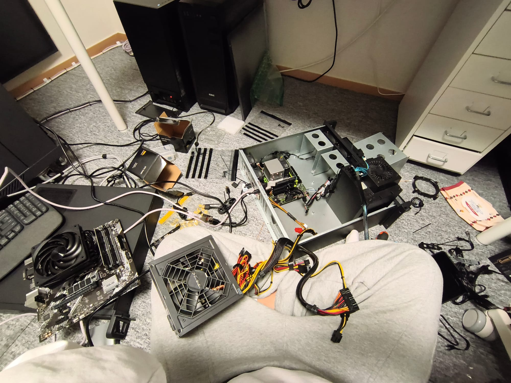
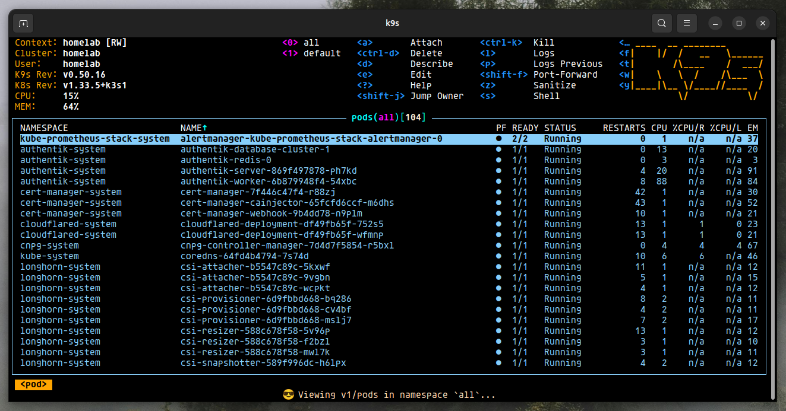
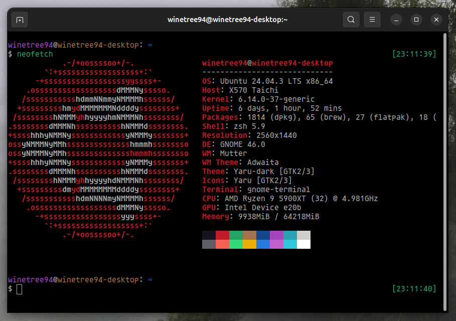
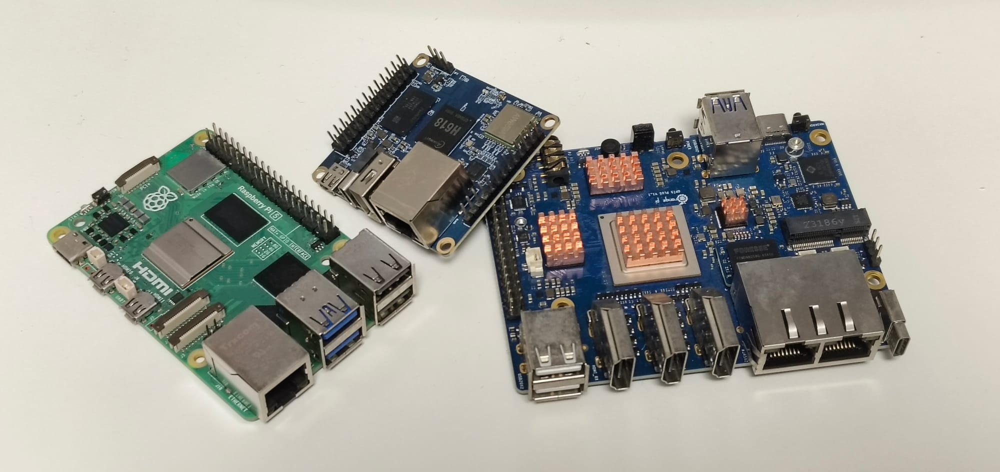
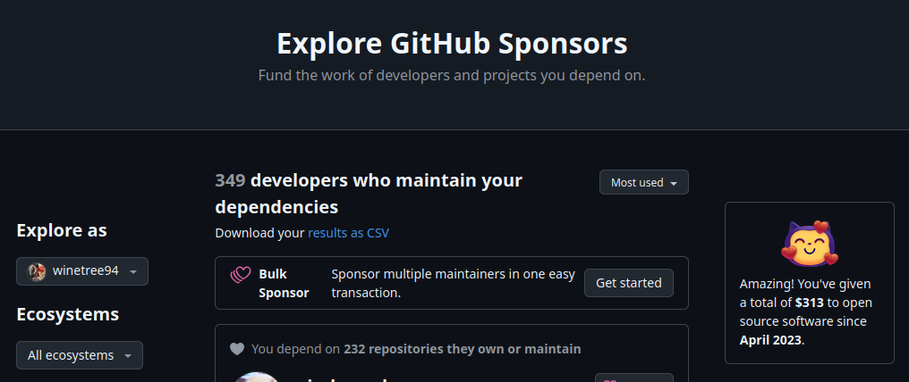
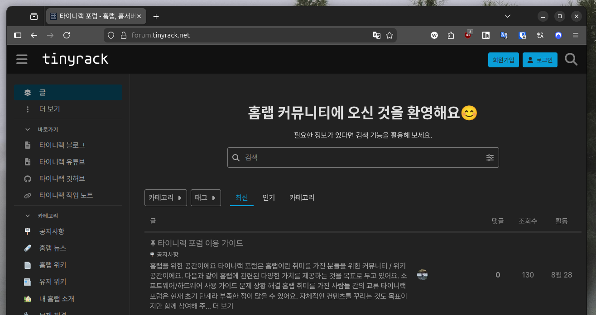

会社での仕事は主にウェブのフロントエンド開発です。でも会社の外では、もう少し幅広い分野の開発や趣味を続けています。私のことをもう少し知ってもらえるよう、好きな分野や学んでいる分野を紹介します。

---

## セルフホスター

趣味の中でいちばん深くのめり込んでいるのは、なんといってもホームラボ（Homelab）です。メール、メモ、ブログ、クラウドストレージなど、現代人にとって大事なインターネットサービスを、自分の部屋のサーバーで運用しています。

なので、私はちょっとした DevOps エンジニアでもあります。家の中のネットワーク、ハードウェア、仮想環境、そして Kubernetes まで管理する（私ひとりだけの）重大な任務を負っているからです。おかげで、停電のような天災や自分のミスでサービスが壊れると、人生が崩れ落ちるような気分を味わうこともあります。

ハードウェアの調子が悪いときは、こんなふうに家の中が大惨事になることもあります。

フロントエンド開発者には似合わない変わった趣味ですが、こうした活動が逆に仕事で役立つこともありました。いつの間にか、今は社内ネットワークの DevOps も担当しています。

---

## オンプレミス Kubernetes

ホームラボのインフラは、仮想マシン（VM）からコンテナへ、さらに単一のコンテナからコンテナオーケストレーション環境へと少しずつ発展させてきました。今ではほとんどのサービスを単一ノードの Kubernetes 環境で動かしています。

自宅はパブリッククラウド（AWS、GCS など）ではないので、マネージド Kubernetes の恩恵は受けられません。そのため、クラスタのすべての構成要素を自分で管理するオンプレミス方式を採っています。しかもステートフルなワークロードを自分で動かしているので、誰もが避けたがる**ステートフル（Stateful）な Kubernetes** です。

そんなわけで、Kubernetes とステートフルなエコシステムの発展に強い関心があり、新しいものが出るたびに試してみるのを楽しんでいます。実のところ、怠けていると自分のインターネット生活が麻痺しかねないので、半ば強制的でもあります。

家の中にここまで必要ないのは、自分でもわかっています。でも趣味というのは、だんだん必要以上にやりすぎてしまうものですよね。皆さんもそうですよね？ :>

---

## Linux

私は Linux のファンであり、積極的なユーザーでもあります。すべてのサーバーで Ubuntu Server を使い、デスクトップとノートパソコンでは Ubuntu Desktop を使っています。デスクトップ環境は GNOME が好みです。

それだけでなく、さまざまなディストリビューションやデスクトップ環境を尊重していて、どれも好きです。Debian や Fedora は新しいバージョンが出るたびに自分で使ってみますし、Cinnamon、MATE、KDE などいろいろなデスクトップ環境を試すのも楽しんでいます。

いつか Linux がデスクトップ OS 戦争で Windows や Mac より優位に立つ日を楽しみにしながら暮らしています。簡単ではないでしょうが、Steam の Proton のおかげでその日が来るかもしれないと思っています。

---

## 組み込みコンピューター

小型で低消費電力の組み込みコンピューターのオタクでもあります。安い価格で、10W 未満のコンピューターがこなせる仕事を眺めていると、なんだか誇らしい気持ちになるんです。なので、ARM や RISC-V ベースの CPU を搭載したコンピューターの進化をいつも楽しく見守っています。

ハードウェアでは韓国の Hardkernel の製品がいちばん好きで、Raspberry Pi、Orange Pi、FriendlyElec など、さまざまなメーカーの製品も買って使っています。Raspberry Pi を除くと、この分野はほとんど中国・台湾のメーカーが主流なので、多様性が少し物足りなくもあります。

最近いちばん注目しているのは、完全な UEFI に対応した CIX の CD8180 CPU です。いつかこうしたコンピューターが標準化されたブートプロセスを備え、x86 環境のように自由にソフトウェアをインストールできる日が来ることを期待しています。

---

## オープンソースのスポンサー

ホームラボ、Linux、組み込みコンピューターという私の趣味は、オープンソースエコシステムのボランティア開発者の皆さんのおかげで続けられています。なので、少額でもこうした開発者を支援するようにしています。

現代のソフトウェア開発では、もはやすべてを一から作ることはできず、新しいソフトウェアのほとんどがオープンソースをレゴブロックのように組み合わせて作られています。だからこそ、オープンソースを使う企業がスポンサーについてもう少し真剣に考えてくれることを願っています。

---

## Tinyrack

ホームラボという趣味を共有し、気軽に学べるプラットフォームを作るのが夢です。そのために [Tinyrack](https://tinyrack.net) というブログとコミュニティを作って育てています。

本業がかなり忙しいので、まだ大きく投資できてはいませんが、いつかは「ホームラボといえばここ」と思い浮かぶ場所に育てたいと思っています。興味があれば、ぜひ一度訪れてみてください。
