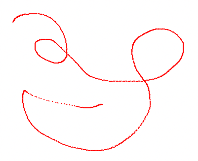
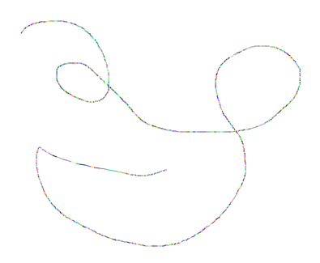
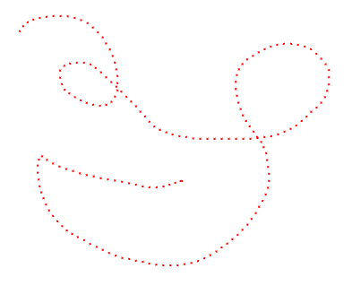
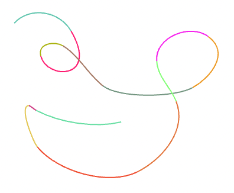

> 💡 このプロジェクトは Public Archive の状態で、今後はメンテナンスされません。

Vector Optimizer は、ベクターを最適化するユーティリティです。点どうしの相関関係を把握して最適化し、自然な曲線を作ります。プロジェクトは [GitHub](https://github.com/winetree94/VectorOptimizer) で管理しており、[NPM](https://www.npmjs.com/package/vector-optimizer) で配布しています。[Live Preview](https://winetree94.github.io/VectorOptimizer) で実際に使ってみることができます。

> このプロジェクトは、[Bobby Fraser's 'Vector Optimizer' C# Project](https://gitlab.com/burningmime/curves) を JavaScript / TypeScript で再実装したものです。

---

### Core Concept

まず、ブラウザ上でユーザーがペンやマウスを使って何かを描ける機能を提供するとしましょう。ふつうはユーザーのカーソルの動きを追跡して点を記録し、点は次のように記録されます。

ユーザーが求めている結果は、点ではなく 1 本の線でしょう。絵を完成させるためにこれらの点を直線でつなぐと、結果は次のようになります。

これでもある程度は見られます。しかし、いくつか問題があります。

* 点と線の数が多すぎて、絵のデータサイズが大きくなります。つまり保存コストが増えます。
* ベクター演算が大幅に増えるため、複雑な絵を描くほど性能が落ちます。
* ユーザーは曲線を描いたのに、曲線ではなくガタガタの線になってしまいます。

Vector Optimizer はこれらの問題を解決します。まずユーザーが描いた点どうしの相関関係を把握し、最適化して一定の間隔で点を減らします。この過程では線形補間（Linear Interpolation）を使います。最適化した点は次のようになります。

そして前の過程をもとに、最も最適化された 3 次ベジェ曲線（Cubic Bézier Curve）を見つけて最終的な絵を完成させます。完成した絵は次のとおりです。

最終結果を見ると、線の数が大きく減りながらも、ユーザーが描いた曲線をうまく表現できていることがわかります。必要であれば最適化の度合いを調整し、ユーザーの入力をさらに自然に表現できます。
